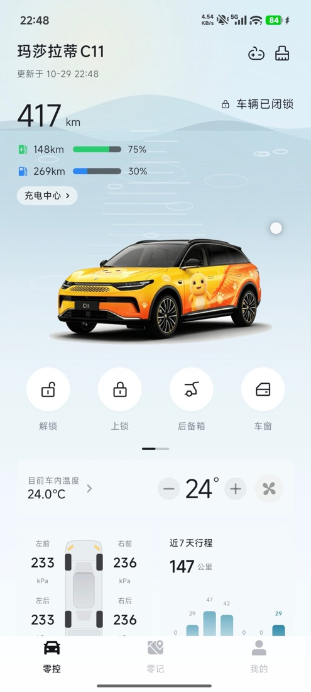
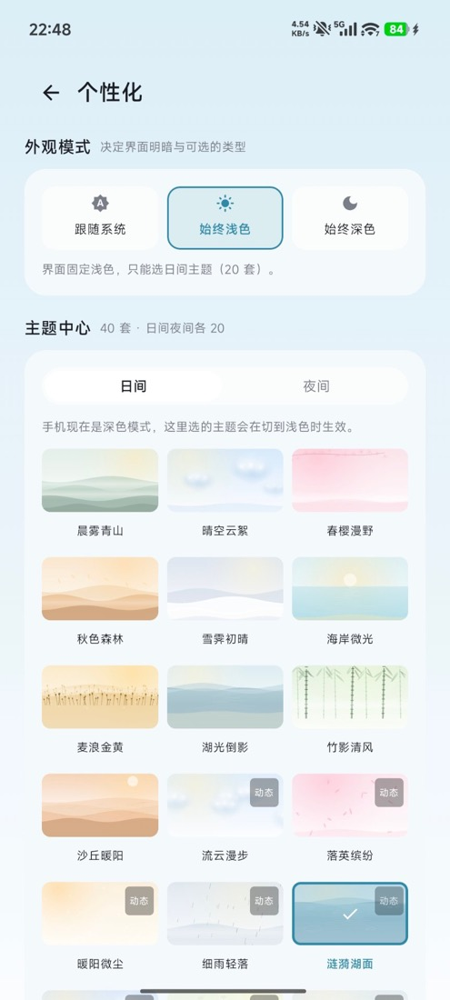
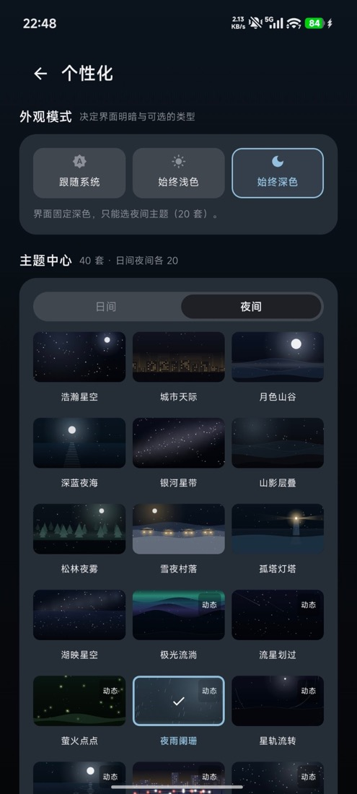
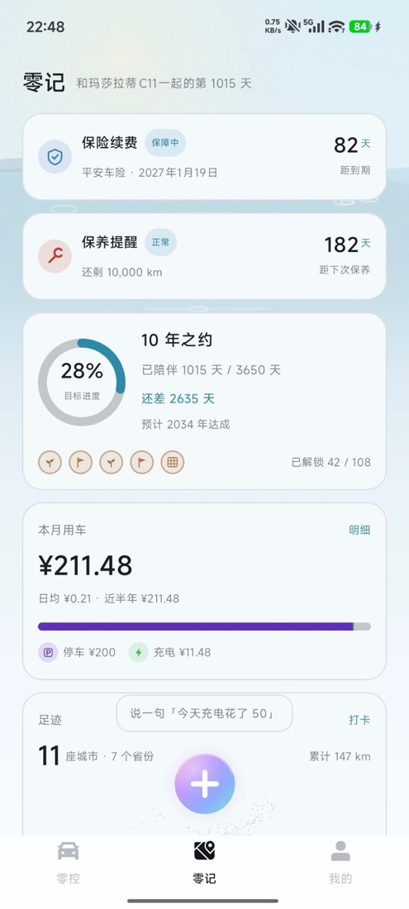
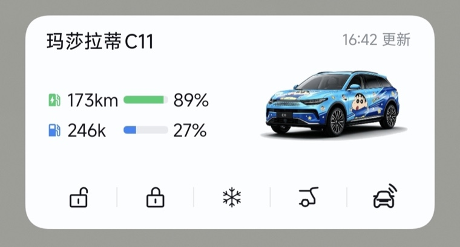
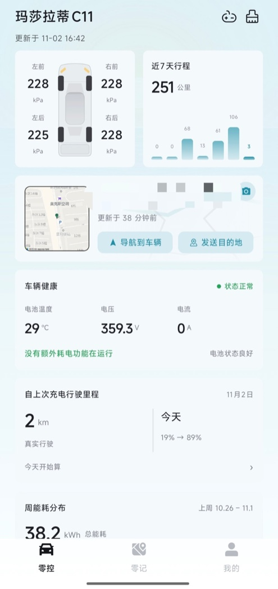

# 零控（LeapControl）

零跑汽车第三方控车 Android 应用（公开版），包名 `com.leapcontrol.personal`。

**完全免费 · 无广告 · 无订阅 · 无内购**。零控由车主自发开发，是**非官方**客户端，与零跑汽车官方无任何隶属、授权或合作关系。

> 📖 **本仓库用于个人学习与技术研究**：<https://github.com/enjoyitxml/LeapControl-Personal-use-version>，基于开源项目二次开发。
> 本仓库不含任何品牌标识，源码全部公开，欢迎查阅与自行编译。

| | |
|---|---|
| 本仓库 | <https://github.com/enjoyitxml/LeapControl-Personal-use-version> |
| 原项目 | <https://github.com/stephenwang1011/leapauto> |
| 原作者 | **stephenwang1011** |
| 使用成本 | 完全免费，无广告、无订阅、无内购 |

> 零控不是从零写起的：车云协议梳理、BLE 无感蓝牙钥匙、国密鉴权这些最难的底层工作由原作者完成并开源，本项目在其基础上重做了界面与交互。原作者署名与项目出处完整保留，详见「[开源协议与致谢](#开源协议与致谢)」。

## 界面预览

| 首页 | 个性化 · 日间 | 个性化 · 夜间 | 零记 |
|:---:|:---:|:---:|:---:|
|  |  |  |  |
| 续航、车模与快捷控车 | 主题中心 · 日间 20 套 | 主题中心 · 夜间 20 套 | 用车目标、成本与足迹 |

完整记录见 [CHANGELOG.md](CHANGELOG.md)，历史安装包在 [Releases](https://github.com/enjoyitxml/LeapControl-Personal-use-version/releases)。

## 特色功能

| 桌面小组件 · 4×2 | 首页一眼看全 |
|:---:|:---:|
|  |  |
| 不开 App、不解锁手机，桌面上抬手就控车 | 停在哪、跑了几公里、电池好不好，一屏看完 |

### 桌面小组件：桌面上就能控车

4×2 一张卡，**续航、车模、五个可替换的控车键**全在上面：默认解锁 / 上锁 / 空调 / 后备箱 / 鸣笛寻车，
在「个性化 → 桌面小组件 → 控车按钮」里可以逐格换成车窗、电池预热、遮阳帘或**哨兵模式**（共 9 个动作，还能调顺序）。
哨兵按钮的开 / 关判定与零控首页同一份规则，共享账号没权限时会直接说明原因。

- 续航按车型自动分辨：纯电一行「173km · 89%」，增程分「电 / 油」两行，电绿油蓝，进度条一眼看出还剩多少
- **右上角提示会明说车正在发生什么**：车辆已解锁 / 空调已开启 / 后备箱已开启 / 车窗已开启 / 电池预热已开启 /
  遮阳帘已开启 / 哨兵已开启；充电中额外带上**剩余时长**（`充电中 · 剩1时23分`）。多项同时开着折成
  「第一条 · 等N项」，不会被 118dp 的宽度截成半句；**高亮文字颜色**可在「个性化 → 桌面小组件 → 颜色与背景」里自定义，三套版式都生效
- **三套版式**随时换（默认**全透明**）：**素纸**最像系统自带小组件，**沉浸**让照片铺满整张卡（可挑一张相册照片当底图），
  **全透明**把字和按键直接浮在壁纸上；桌面上已有的卡片立刻跟着变
- 空调与后备箱按**本地记录的开合态**取反 —— 部分车型车况里根本不上报这两个信号，靠车况判会永远「只能开不能关」
- 五个按键的**圆角底色与竖向分隔线各有一个独立开关**：默认只留四条细线、不带底色（最接近「直接浮在壁纸上」），
  想要色块就把底色打开，觉得按键挤就把线擦掉，两者互不影响
- 左上角的**车标默认不显示**（车名占满整行），要用在「个性化 → 桌面小组件 → 大小」里打开；
  **大小可以分四处微调**：信息区（车名 / 续航 / 进度条）、五个控车图标、右上角的更新时间与刷新键、左上角的车标。
  后三根只在各自**固定格子**里收放图形，格子、分隔线、五格均分和点按范围一律不动；时间文字有省略号兜底，
  放大也不会把刷新键挤出卡片；车标的左缘固定，放大缩小都不会把车名推走 ——
  「个性化 → 桌面小组件 → 大小」里有一张画出格子边框的示意，拖滑杆时能直接看出「框没变、内容变了」
- 刷新走**增量更新**，只推变化的数字与高亮，不会整张卡重画、不闪、不重新解码壁纸

### 自上次充电行驶里程：这一箱电到底跑了多少

车端没有「充电记录」接口，零控就用**观测式**：充电时车停着，把此刻的表显总里程记下当起点，之后相减 —— 得到的是**真实行驶里程**，而不是剩余续航那个估算值。

- 口径是**总里程差值**（表显优先），不掺剩余续航，两个口径相减能差几十公里
- 另起一次充电看两条硬证据：中间看见过「没在充电」（车开走、App 刷新过一次车况）、或里程差超过 0.5 km —— 一天充两次也不会接着上午的数字累加
- **充电期间的记录和行程轨迹同一套方案**：任何一帧车况看见「正在充电」就自动接管，前台服务 + 精确闹钟保活、**每 1 分钟同步一次车辆信息**，把「充到多少」「最后一次还在充电的时刻」记到分钟级；一捕捉到**停止充电**就当场定格结束时间 / 电量 / 里程，然后撤闹钟、停服务，**不再拉取车况**，避免一直后台耗电
- 卡片永远写清「上次充电 X 月 X 日」，随时可以「从现在起算」重新锚定；整次充电一次都没赶上时还能手动修正时间 / 充到多少 / 当时总里程

### 查看车辆实时位置：车停在哪条街，一句话说清

首页一张卡里两件事：左边**实况地图缩略** + 中文地址（精确到「奥克斯维京」这种地标），右边两个按钮。

- 「更新于 38 分钟前」是**位置本身的年龄** —— 车 50 米内没动就一直沿用同一个时点，不会刷新一下就谎报「刚刚」
- 点缩略图进**找车页**：大图、复制坐标、拍一张停车位照片（地库灯暗时可全屏放大，看清柱子上的号码），整张图偏了几百米还能直接选坐标系（自动 / WGS-84 / 百度）一键纠正
- 深色主题下地图自动翻色，不刺眼，也不破坏配色
- 零控自己**不存地图**：静态图与地址解析都走你自备的高德 Web 服务 Key，不填也能看车端上报的坐标

### 导航到车辆：一键走到车跟前

点「导航到车辆」，**步行（默认）/ 骑行 / 驾车**任选，直接调起你手机里的地图 App；点「发送目的地」则把搜到的地点推到车机，上车接着导航。

- 点导航前会先刷一次车况，用的一定是最新坐标，不会把你导到半小时前的位置
- 进地库会主动提醒：卫星信号在这儿必然中断，标点通常停在入口或马路上，配合车位照片确认更靠谱

### 行程轨迹：这一趟怎么走的，回头能看

车况接口只给**一帧快照**，没有历史轨迹。零控的做法是：**你点「开始记录」，它就按你设的间隔
自己去读车况记点**（默认 45 秒，可选 10 / 15 / 20 / 30 秒与 1 / 2 / 3 / 5 分钟），锁屏、切到别的 App 都照采。

- **只有手动记录**：上车点一次「开始记录」，那一刻就是出发时间；车一动就自动记的方案已经删掉
  （挡位信号噪声会让它一打开 App 就「正在记录」）
- **后台怎么保证记到**：三层保险 —— `dataSync` 前台服务常驻（通知栏显示「正在记录行程」）+ 精确闹钟兜底
  （服务被清掉时照样按间隔采）+ 电池优化白名单引导。比无障碍服务更稳，也不需要用户去系统设置里开敏感权限
- **结束三路兜底**：手动点「结束行程」/ 停稳 5 分钟 / 锁车或整车下电；后两者结束时间回拨到刚停稳那一刻，
  这 5 分钟不计入时长。暂停期间一帧都不采，后台采样也停
- **里程按表显总里程相减**（信号 1318），比 GPS 点累加准；能耗优先用云端累计电量，
  读不到才退回首末两帧的电量差；轨迹先纠偏贴回道路、再补齐点与点之间的道路，画出来是你真开过的那条路
- **历史轨迹可以点开放大**：全屏地图，标题写「出发 → 到达时间 · 多少公里」，副标题写「起点地址 → 终点地址」，双指缩放、单指拖动看细节
- **路线画错了可以自己改**：路径规划偶尔把路口判反（明明左拐却画成往右绕）。点开大图 → 右上「修正路线」，**所有操作按钮都在顶部轨迹详情正下方**，字大、点得准，改完点右下角醒目的「确认保存」
  - **只用在正确的路上点途经点这一种修法**：轻点至少 2 个途经点 →「按导航补齐」，由驾车路径规划把点与点之间的道路补出来；途经点是自己放的，方向被强制住，不会重演判反。点错了用「撤一点」，也能逐段「撤销」或「恢复原状」。手画涂抹方案已删除
  - 单指拖动平移、双指缩放照常可用；补齐需要高德 Web Key 且开通驾车路径规划，失败时默认不落线（不画穿楼穿河的线），钉子留着重试。只改变画出来的线，采样点、里程、时长、能耗和起终点地址都不变
- 但口径不糊弄：底部一直带着那句「采样点已纠偏贴路，点间按导航路线补齐 · 不是车辆实际行驶轨迹」——
  放大只让你看清楚，不把推测说成导航。界面上也如实说明「记到点」与「记全」的区别：
  地库没信号、车机没上报坐标时会缺点，轨迹是这些点连起来的示意图

### 行驶动效：车是真的在动

首页车模按车速轻微抖起来，身后飘过风的细线。

- 默认给得很安静：**抖动 0.2dp**、**风密度 35%（约 14 条）**、风向默认 −7°（略往下斜掠，比纯水平更像迎面而来的空气）
- **总开关是真关**：关掉之后动画循环根本不启动，车模是一张纯静态图 —— 不是把幅度调到 0 那种「还在算、只是画不出来」
- 低于 3km/h 一帧都不画；**倒车只抖、不吹风**（车朝后走，风不该继续往后飘）
- 「个性化 → 首页 → 行驶动效」里能分别调抖动幅度、风的密度（10% 的 4 条 ~ 160% 的 61 条）、风向倾角；
  预览条可以自己拨车速试手感，不必真把车开出去

### 首页车窗：点开挑档位，不用一下一下点

点首页「车窗」按钮，**按钮正上方**弹一张小卡片，固定列出关 / 微开 / 半开 / 全开四档，
点哪一档就发哪一档 —— 和官方首页是同一个交互。不按当前档位过滤：档位靠车端回执推断，
回执丢了本地会把窗当成关着，若过滤掉「关闭」，用户明明看见窗开着却点不到关闭。

- 菜单只写文字、不画图标：四个「车窗轮廓 + 不同高度」在 22dp 下根本分不出来
- 档位只在**实际执行成功**后才记住：没开成不会让按钮文字（车窗 / 车窗·全开）谎报状态
- 磁贴和桌面小组件**仍然是四档循环**（点一下往后走一档），两种交互各留一套，不强行统一

### 控车结果说真话：成功、没变化、读不到，分得很清

网关回「受理」只代表指令进了队列，**不等于车端执行**。所以每次控车都会回读车况求证，结论只有四种：

| 结论 | 什么情况 |
|---|---|
| 「执行成功」 | 车况信号确实变成目标值了 |
| 「指令已发出，但车辆状态还没变化」 | 读得到信号、但窗口内没变 —— 不说成功，也不冤枉说失败 |
| 「已发出，但读不到车况」 | 这条指令有可回读信号，却一次都没读到 —— 绝不替车端宣布成功 |
| 「执行成功」（按网关回执） | 鸣笛、电池预热、充电枪这类本来就没有回读信号 |

> 车窗这种慢指令单独放宽：等网关回执 10 秒、再求证 6 秒；窗口内连「受理」都没拿到，
> 会**自动补发一次**（指令本身幂等，重发不会把窗开到别处）。
> 以前那种「点完一直转圈、刷新一下弹个成功、其实窗没动」的假成功，就是这套判定修掉的。

## 目录

- [界面预览](#界面预览)
- [特色功能](#特色功能)
- [功能概览](#功能概览)
- [环境要求](#环境要求)
- [常用命令](#常用命令)
- [跑单元测试](#跑单元测试)
- [在本机模拟器里测试](#在本机模拟器里测试)
- [版本管理规范](#版本管理规范)
- [目录结构](#目录结构)
- [开源协议与致谢](#开源协议与致谢)
- [隐私条款](#隐私条款)
- [免责声明](#免责声明)
- [安全须知](#安全须知)

## 功能概览

- **首页**：总续航（纯电单条 / 增程电量+油量双进度条）、车辆状态（行驶状态、闭锁、车窗、后备箱、遮阳帘）
- **车模**：官方 3D 模型，按车辆档案下发的车型、车漆色号、车顶色、座椅实时渲染（和官方 App 同一套模型），**横向拖动可以转车身**；首次进首页在后台下载约 12MB，之后永久缓存。官方没给 3D 包的车型自动退回 2D 定妆照，渲染失败也不留空位
- **行驶动效**：车模按车速轻微抖动 + 飘风线，总开关一键关掉（关掉后动画循环完全不启动）；抖动幅度、风的密度（10%~160%）、风向倾角都能调，低于 3km/h 不画、倒车只抖不吹风
- **快捷控车**：常用指令一排圆钮（解锁 / 上锁 / 后备箱 / 车窗 / 鸣笛 / 电池预热 / 遮阳帘）
  - 车窗点开是**档位菜单**，在按钮正上方弹出、固定列出关 / 微开 / 半开 / 全开四档，点哪档发哪档（不按当前档位过滤，回执丢失时也能点到「关闭」）；档位按实际成功才记住
  - 每条指令都有**结果求证**：只有车况真的变了才说「执行成功」，没变说「还没变化」，读不到车况就直说读不到
- **车辆位置与目的地**：一张卡里两件事 —— 左边 96dp 见方的实况地图缩略 + 中文地址（车停在哪条街）、右边两个按钮「导航到车辆」（步行 / 骑行 / 驾车可选）和「发送目的地」；点缩略图进找车页可看大图、拍车位照片、复制坐标、按需选对坐标系（自动 / WGS-84 / 百度）纠正整块偏差
- **发送到车机**：按关键字搜全国的地点 / 停车场 / 充电站，选中后调起高德路径规划，手机与车机登录同一个高德账号，上车自动提示继续导航
- **桌面小组件**：4×2 与 5×2，五个可替换的控车键（默认解锁 / 上锁 / 空调 / 后备箱 / 鸣笛寻车，可换成车窗 / 电池预热 / 遮阳帘 / 哨兵模式）+ 续航，**素纸 / 沉浸 / 全透明**三套版式随时切换（默认全透明、按键不带底色），桌面上已有的卡片立刻跟着变
  - 续航按车型分辨：纯电一行，增程分「电 / 油」两行，图标与进度条电绿油蓝
  - 右上角提示会明说解锁、空调、后备箱、车窗、电池预热、遮阳帘、哨兵是否开启，充电中显示剩余时长；提示高亮色可自定义
  - 空调 / 后备箱按**本地记录的开合态**取反 —— 部分车型车况里不上报这两个信号，靠车况判会永远只能开不能关
  - 五个按键的**圆角底色**（默认关）与**竖向分隔线**（默认开）各有独立开关，可以只留水波不要底、也可以擦掉线
  - 左上角**车标默认不显示**，要用的自己打开；车标、图标、右上角时间与刷新键都能各自微调大小（80%~125%），格子与点按范围不变
- **行程轨迹**：手动记录（开始 / 暂停 / 恢复 / 结束，暂停不计里程与时长）；开始后后台按设定间隔（10 / 15 / 20 / 30 秒、45 秒、1 / 2 / 3 / 5 分钟，默认 45 秒）定时采点，前台服务 + 闹钟 + 电池白名单三层保活，锁屏照采；停稳 5 分钟或锁车也会兜底收尾。里程按表显总里程相减，能耗云端优先，轨迹纠偏贴路后补齐点间道路；历史轨迹地图**可点开放大**（双指缩放 / 单指拖动），路口判错可**在正确的路上选几个点、按导航补齐**那一段路线
- **行车概览**：胎压俯视图、总里程 / 电流 / 门锁 / 车窗状态、空调开关条、近 7 天行驶里程图表
- **充电中心**：大字 SOC + 健康充电 / 充电上限 / 预约充电 / 预约电池预热 / 绑桩，可下发到车端
- **自上次充电行驶里程**：车端没有充电记录接口，改为观测式 —— 充电时车停着，记下表显总里程作为起点，之后相减得到这轮真实跑了多少公里（口径是**总里程差值**，不是剩余续航差）
- **空调模块**：开关空调、±调温（16~32°C）、车内实时温度
- **空调面板**：开关、±调温（16~32°C）、极速升降温、除雾除味、风量、内外循环、出风方向
- **座椅舒适**：座椅加热/通风 0-3 档、方向盘加热、后视镜加热
- **车载冰箱**：开关、冷藏/暖饮、温度档位、急速制冷
- **零记 · 仪表盘**：顶部三格读数（陪伴天数 / 累计里程 / 本月用车）→ 按自定义顺序排列的块 → 编辑入口；**108 枚勋章**分 8 组（陪伴 / 里程 / 目标 / 城市 / 省份 / 记账 / 单日 / 分类）、四档金属色，一直有下一枚可拿
- **零记 · 灵感球**：底部一枚白瓷质感的呼吸球，中间一个「+」—— 点一下旋成「×」并弹出输入条（再点收起）、长按说话（Siri 式语音浮层，实时声量驱动球体），一句「今天充电花了 50」「今天点亮了杭州」直接落账 / 打卡；位置默认右下，可在个性化里切到中间 / 左下
  - 语音**不再依赖设备自带的语音服务**：App 自己录音（16k PCM）后交给百度短语音转写，到「设置 → 语音识别（百度）」填 API Key / Secret Key 即可；未填时退回系统识别
- **零记 · 用车成本**：一句话记账（手打或语音），自动认分类与金额；**今日 / 本周 / 本月 / 今年 / 全部**五档切换，趋势图跟着换粒度（按天 / 周 / 月 / 年），占比环 + 分类排行（每类一个小图标）
- **零记 · 城市打卡**：点亮去过的城市、插小红旗（**按省份上色**），足迹图可**双指放大、单指拖动**；**心愿单**记录想去的城市，去过了打卡自动划掉；按日记录行驶里程（数据只存本机，不上传）
- **数据安全**：零记全部记录存一个文件（`journal.json`），原子写 + 覆盖前转备份 + 留 14 份日快照 + 读失败即拒写；每天自动备份一份到 `Download/LeapControl/`（留 7 份），换机 / 重装可导入恢复
- **其它**：多车切换、40 套实时绘制背景主题（日间 / 夜间各 20 套）、深浅配色、系统控制中心磁贴、更新检测频率可调（每次启动 / 7 / 14 / 30 天 / 关闭）、意见反馈入口

> **非全系标配的功能会自动隐藏。** 服务端没有「车型配置清单」接口，判据是车况信号本身
> （详见 `VehicleCapabilities.kt`）：
> - 冰箱 / 哨兵 / 座椅 / 方向盘 / 后视镜：不带该硬件时网关不下发这组信号 → 信号缺失即判定没有
> - 天窗：未选装的车网关**照样下发** `1718`，只是值是 CAN SNA 占位（15 / 150 / 255）
>   → 必须做 0..10 的值域判定，只看「有没有这个 key」会把所有车都判成有天窗
> - 前备箱：仅 D19 系列，按车型名识别
>
> 识别结果按 VIN 持久化且**粘滞**（观测到一次即永久生效），避免车休眠导致信号临时缺失时
> 模块忽有忽无。这套判据有 15 个单测守着：见下方「跑单元测试」。

> **车辆位置需要自备一把高德 Web 服务 Key**（免费申请，填一次长期有效）。
> 零控自己不存地图：地址解析、静态地图、关键字搜索都调高德的两个接口。
> 入口在「设置 → 地图与目的地 → 高德 Web Key」，**也可以直接点找车页右上角的「?」**——
> 那里同时有申请教程和输入框，配完当场就能用；想先看「配了能干嘛、怎么申请」的全过程，
> 到「我的 → 玩法说明 → 配置高德 Key」，那一节可以直接打开高德控制台。注意服务平台必须选「Web 服务」，
> 选「Android」要绑包名和签名指纹，填进来一定用不了。

## 环境要求

| 项 | 版本 |
|---|---|
| JDK | **21**（构建必须指定，否则 AGP 8.7 会报错） |
| Android SDK | compileSdk 35 / buildTools 35.0.0 |
| 最低系统 | Android 8.0（API 26） |

`local.properties` 里的 `sdk.dir` 是本机路径，**已被 git 忽略**，不会上传。

## 常用命令

```bash
cd LeapControl

# 构建调试包
JAVA_HOME=$(/usr/libexec/java_home -v 21) ./gradlew :app:assembleDebug --no-daemon -q

# 构建分发包（release 变体：R8 + 资源压缩，约 3.4MB；仍是 debug keystore 签名）
JAVA_HOME=$(/usr/libexec/java_home -v 21) ./gradlew :app:assembleRelease --no-daemon -q

# 产物（文件名带版本号，见 app/build.gradle.kts 的 androidComponents）
app/build/outputs/apk/debug/LeapControl-<版本>-debug.apk
app/build/outputs/apk/release/LeapControl-<版本>.apk
```

两个变体的签名完全相同（都用 debug keystore）：这是刻意的 —— 车友装的历史包都是 debug 签名，
换签名会导致「应用未安装」，只能卸载重装，而卸载会带走零记、行程这些本地数据。
体积差得很大（26MB → 3.4MB），所以**分发一律用 release 变体**，debug 只用来本机调试。

日常最省事的还是用发版脚本（见下），它会负责改版本号、构建、写变更记录、打标签。

---

## 跑单元测试

纯 JVM 单测，不需要模拟器和手机。车况信号解析、车辆配置识别这类「容易改坏且看不出来」的
逻辑都在这里：

```bash
./scripts/emu.sh test                       # 等价于 ./gradlew :app:testDebugUnitTest
# 或
JAVA_HOME=$(/usr/libexec/java_home -v 21) \
  ./gradlew :app:testDebugUnitTest --no-daemon
```

目前 **1334 个用例**，覆盖的都是「容易改坏且看不出来」的地方：

- `VehicleCapabilityDetector`：天窗 SNA 占位值不能被误判成有天窗、座椅按座位精确识别、后风挡加热不能当作后视镜加热、粘滞合并不会因为信号临时缺失而丢失配置
- 控车结论（`ControlOutcomeText`）：求证通过 / 读到没变 / 读不到车况 / 本来没有信号，四格文案一个不许说错
- 行程轨迹：自动开场只认「行驶那一帧」、驻车 5 分钟收尾后结束时间要回拨、手动暂停的时长靠累计值算而不是分段倒推
- 轨迹地图：取景层级、放大锚点、瓦片与折线是否同一套坐标；以及「地图铺满 + 浮层避让」的版式
- 行驶动效参数迁移（老用户存着的旧默认值要能认出并升级）、车型代号归一、车窗档位菜单、小组件版式

---

## 在本机模拟器里测试

本机已配好 Android 模拟器（AVD 名 `LeapControl_Test`，Pixel 7 / Android 15 / x86_64），所有操作收在一条命令里：

```bash
cd LeapControl

# 一键全流程：构建 → 启动模拟器 → 安装 → 打开 App
./scripts/emu.sh

# 其它常用子命令
./scripts/emu.sh start          # 只启动模拟器并等它就绪
./scripts/emu.sh stop           # 关闭模拟器
./scripts/emu.sh status         # 看模拟器 / App 状态
./scripts/emu.sh shot           # 截图到项目根（零控-月日-时分秒.png）
./scripts/emu.sh log            # 看 App 实时日志（Ctrl+C 退出）
./scripts/emu.sh install xx.apk # 单独安装某个 APK
./scripts/emu.sh --no-build     # 跳过构建，直接装现有 APK
./scripts/emu.sh --cold         # 冷启动（丢弃快照，干净开机）
```

说明：

- 构建产物会照常复制一份到上层目录 `零控-debug.apk`，习惯不变
- 渲染走**本机 GPU**（AVD 里 `hw.gpu.mode=host`），比默认的软件渲染流畅得多；
  传感器 / 音频 / GPS 也关掉了，少一批无用开销。若在本机 GPU 上出异常，加 `--software` 退回 CPU 渲染
- 开机走快照快速启动：首次约 1 分钟，之后 10 秒内；`--cold` 强制干净开机
- 觉得界面动画拖沓，可把动画缩放调低（立即生效，无需重启）：
  ```bash
  adb shell settings put global window_animation_scale 0.5
  adb shell settings put global transition_animation_scale 0.5
  adb shell settings put global animator_duration_scale 0.5
  ```
- 脚本会自动找 SDK（`ANDROID_HOME` → `local.properties`），换机器也能用；AVD 不存在时会自动创建（必要时自动下载系统镜像）
- 想换设备型号改脚本里的 `AVD_NAME` / `DEVICE` 即可

### 已知限制：x86 模拟器上登不了账号

登录依赖零跑内置的数美设备安全组件（`libsmsdk.so`），该库**只发布了 arm64-v8a 版本**。
x86 / x86_64 的 PC 模拟器只能靠二进制翻译去执行它，而它内部有动态生成的代码，
翻译执行时必然触发 `SIGSEGV` —— native 崩溃在 Java 层捕获不到，表现为**点登录就闪退**。

现在代码里已加了架构判断（`ShumeiSecurityManager`）：非 ARM 设备直接跳过该组件，
不会再闪退，点登录会给出明确提示「当前设备无法加载安全组件（x86 模拟器不支持），
登录请在真实 ARM 手机上进行」。**模拟器适合看 UI 和调试界面，登录与控车请在真机上测。**

### 真机调试

手机开好「USB 调试」后用 USB 连上电脑（或在同一 WiFi 下用「无线调试」），脚本会自动优先用真机：

```bash
./scripts/emu.sh devices     # 确认手机被 adb 认到（状态 device，不是 unauthorized）
./scripts/emu.sh             # 直接装到手机上并打开
```

想在电脑上直接操作手机屏幕，装个投屏工具最舒服：

```bash
brew install scrcpy          # 装好后插着手机运行 scrcpy 即可
```

---

## 版本管理规范

### 1. 版本号：语义化版本 X.Y.Z

| 位 | 什么时候进位 | 例子 |
|---|---|---|
| **X** 主版本 | 架构级重构、不兼容的大改 | 0.1.0 → 1.0.0 |
| **Y** 次版本 | 加了新功能 | 加胎压模块 → 0.2.0 |
| **Z** 修订号 | 修 bug、UI 微调、文案改动 | 调间距 → 0.1.1 |

`versionCode` 不必手动管，脚本按 `X*10000 + Y*100 + Z` 自动生成（0.1.0 → 100），保证单调递增，Android 系统会正确识别升级。

### 2. 分支约定

```
main            稳定主线，永远是"能装能用"的状态，只通过合并进入
feat/xxx        新功能（feat/tire-pressure）
fix/xxx         修问题（fix/control-center-offset）
```

一个人开发不需要 develop 分支，改动直接在 `feat/*` 上做，验证后合回 `main`：

```bash
git switch -c feat/tire-pressure     # 开分支
# ... 改代码、构建、手机上验证 ...
git add -A && git commit -m "feat: 新增胎压监测模块"
git switch main && git merge feat/tire-pressure
```

### 3. 提交信息规范

格式：`<类型>: <一句话说明>`（中文即可）

| 类型 | 用于 |
|---|---|
| `feat` | 新功能 |
| `fix` | 修 bug |
| `ui` | 纯视觉调整（间距/字号/颜色/图标） |
| `refactor` | 重构，不改行为 |
| `perf` | 性能优化 |
| `chore` | 构建脚本、依赖、文档等杂项 |

示例：`ui: 续航区三行间距收紧`、`fix: 控车按钮未居中`、`chore(release): v0.1.1`

理由：变更记录 CHANGELOG 是**自动从这些信息生成的**，写清楚省事。

### 4. 发版（一条命令搞定）

```bash
cd LeapControl
./scripts/release.sh 0.1.1
```

脚本依次做：
1. 检查工作区干净（有未提交改动会先提示你处理）
2. 改 `app/build.gradle.kts` 的 `versionName` / `versionCode`
3. 把自上一个标签以来的提交整理成条目，写进 `CHANGELOG.md`
4. 构建 release 变体 APK（R8 + 资源压缩，约 3.4MB），另存为 `release/LeapControl-v0.1.1.apk`（附件名用英文名，GitHub 会过滤文件名中的中文）
5. 提交 + 打标签 `v0.1.1`
6. 推送到 GitHub；若本机 git 协议被网络拦截，自动改用 API 通道同步
7. 在 GitHub 上创建 Release 并把 APK 作为附件上传

**先跳过构建**（只想快速更新版本号时用）：`./scripts/release.sh 0.1.1 --no-build`

### 5. 同步到 GitHub

正常情况下用 `git push` 即可。若出现 `CONNECT tunnel failed 502`（本机代理会拦 `github.com` 的 git 协议），改用：

```bash
GH_TOKEN=<你的令牌> python3 scripts/gh-sync.py
```

它会增量同步：只上传发生变化的文件，提交历史连续累加，不会覆盖已有记录。

---

## 目录结构

```
LeapControl/
├── app/                     源码主工程
│   └── src/main/java/com/leapcontrol/app/
│       ├── Models.kt            指令表（Commands）与预约计划
│       ├── LeapmotorApi.kt      官方接口实现
│       ├── SessionStore.kt      本地偏好与会话（部分走 Keystore 加密）
│       └── ui/                  Compose 界面层
├── gradle/
├── scripts/                 发版与同步工具
│   ├── emu.sh               模拟器一键运行（构建/安装/启动/截图/日志）
│   ├── release.sh           一键发版
│   ├── gh-sync.py           API 通道增量同步
│   └── gh-release.py        创建 Release 并上传 APK
├── CHANGELOG.md
└── README.md
```

---

## 开源协议与致谢

### 原项目

| 项 | 内容 |
|---|---|
| 项目名称 | 零跑智控（leapauto） |
| 原作者 | **stephenwang1011** |
| 项目地址 | <https://github.com/stephenwang1011/leapauto> |

### 致谢

零控不是从零写起的。正是**站在巨人的肩膀上**，才有了今天这个能每天顺手用一用的 App。

原作者凭一己之力啃下了零跑车云协议的梳理、BLE 无感蓝牙钥匙与国密鉴权这些难度极高的工作，
还把整套成果完整地开源出来。代码结构干净、接口注释详尽，连车型差异和信号边界都交代得
清清楚楚 —— 这份工程完成度和分享精神，都值得一句由衷的佩服。零控所做的，只是在这套
扎实的底座上，按自己的用车习惯把界面和交互重做了一遍罢了。

### 协议与署名

1. 本项目遵循原项目的开源协议，**完整保留原作者署名与项目出处**，未删除、未篡改任何版权与声明信息。
2. 若原项目后续调整协议或授权方式，本项目同步遵从；原仓库未单独声明的部分，以原仓库说明为准。
   > 说明：截至本项目公开时，原仓库 `stephenwang1011/leapauto` 未提供显式的 LICENSE 文件，
   > 本项目按原仓库说明使用，并保持署名与出处完整。如原作者对授权有任何异议，请联系删除。
3. 二次开发部分（界面重构、功能模块自定义、四季主题等）已随本项目一并开源，可供学习与自行编译。

### 使用范围

1. 零控本身已在 GitHub 开源：<https://github.com/enjoyitxml/LeapControl-Personal-use-version>，源码可查阅、可自行编译。
2. 二次开发部分同样公开，欢迎提 issue 或 PR 一起完善。
3. 本版本面向个人学习与技术研究，请在学习研究后及时卸载。

### 完全免费

1. 零控**完全免费**：无广告、无订阅、无强制收费，也不出售任何数据。
2. 没有付费版，也没有任何需要付费才能解锁的功能。
3. 如果你认可这份工作，欢迎去[原项目](https://github.com/stephenwang1011/leapauto)给原作者点个 Star —— 那是对开源最好的回报。

---

## 隐私条款

> 隐私不是选项，而是底线。零控从第一行代码开始，就没打算拿走你的任何东西。
>
> 以下条款与 App 内「隐私条款」页面内容一致。

### 一、完全免费

- 零控是完全免费的自用工具：无广告、无订阅、无内购、无强制收费，也不存在任何「解锁高级功能」的付费墙。
- 所有功能对所有用户一视同仁开放，没有任何需要付费才能解锁的功能。
- 本项目基于开源项目二次开发，源码已在 GitHub 公开可查，数据处理方式以本页说明为准。

### 二、数据全部存在本地

- 登录凭证、控车密码、自定义车名、快捷按钮与模块排序等，全部保存在你手机本地的 App 私有目录，不会上传到任何服务器。
- 控车密码使用 Android Keystore 硬件密钥 + AES-GCM 加密存储，App 自身也无法导出明文。
- 车况数据只在需要展示时读取，用完即弃，不常驻后台、不做任何形式的留存与转发。
- 卸载 App 会一并清除全部本地数据；服务器侧不存在属于零控的账号数据。

### 三、不收集任何隐私

- 不收集、不上传手机号、通讯录、短信、相册、定位、设备标识符等个人敏感信息。
- 不采集车辆位置轨迹：车辆经纬度仅在内存中按需驻留，绝不写入日志，也绝不上传。
- 不集成任何第三方统计、广告、行为埋点或云端崩溃上报 SDK —— 崩溃信息只在本机弹给你自己看。
- 不做后台常驻、不做静默唤醒：除了下面列出的启动版本检查和你主动发起的操作，App 不会在后台偷偷联网。

### 四、联网只做这几件事

- **登录与验证码**：直连零跑官方服务，仅用于校验你的车主身份。
- **车况读取与远程控车**：指令经零跑官方云端接口下发，路径与官方 App 完全一致。
- **车模（2D 定妆照与 3D 模型包）、行驶里程与能耗统计**：同样取自零跑官方接口。3D 模型包整包原样下载到本机，只在本地用 WebView 渲染，不做任何二次上传。
- **车辆位置与目的地**：车端上报的经纬度只在内存里按需驻留；要画地图、把坐标翻成中文地址、按关键字搜目的地时，才会带着坐标去请求高德的两个接口，且依赖你自行填写的高德 Web Key —— 不填则完全不发起这些请求，只显示车端上报的坐标。
- **版本更新检查**：启动时向 GitHub 的公开 Releases 接口查一次最新版本号，匿名请求，不携带任何个人信息，也不上传任何数据。

### 五、使用范围

- 本版本面向个人学习与技术研究，源码公开，欢迎查阅与自行编译。
- 软件按现状提供，不做任何形式的可用性承诺；如后续停止维护，恕不另行通知。

### 六、你的权利

- 你可以随时删除本地数据、退出登录或卸载 App，无需任何申请。
- 若本条款后续有调整，会在这个页面同步更新说明。
- 如发现任何与本条款不符的行为，请立即卸载并停止使用 —— 那一定不是本软件的预期行为。

---

## 免责声明

**第三方零跑控车软件（零控 LeapControl）免责声明**

尊敬的用户，在使用本软件前，请您认真阅读并完全同意以下全部条款。您下载、安装、使用本软件，
即代表您已充分知晓、理解并自愿接受本免责声明所有内容。

> 以下条款与 App 内「免责声明」页面内容一致。

### 一、软件性质说明

1. 本软件为个人开发的第三方辅助控车工具，**非零跑汽车官方出品、非官方授权、非官方关联软件**。
2. 本软件基于开源项目二次开发而来，源码已在 GitHub 公开，可自由查阅。
3. 本软件仅为用户提供便捷控车、车况查看、自定义辅助功能，所有车辆底层权限、车辆协议均来源于用户设备本地合法授权，不破解、不篡改、不绕过官方安全机制。
4. 本软件与零跑官方品牌、公司、系统无任何隶属、授权、合作关系，所有功能仅供车主个人学习、自用、体验。

### 二、使用风险告知

1. 车辆智能控制存在网络延迟、协议波动、车辆休眠、系统兼容、官方接口变更等不可控风险，用户明确知晓：控车操作存在失效、延迟、异常的可能性。
2. 用户严禁在车辆行驶过程中进行任何远程控车操作，严禁违规、危险、非法场景下使用本软件，所有危险操作后果由用户自行承担。
3. 因官方 OTA 升级、车辆系统更新、官方协议调整，可能导致本软件功能临时失效、报错、闪退，开发者不承诺永久可用、不承诺无条件更新维护。

### 三、责任完全免除

1. 在法律允许的最大范围内，本软件开发者不对任何直接或间接损失承担任何责任，包括但不限于：车辆功能异常、系统报错、数据异常、电池损耗、车辆故障、财产损失、出行延误、个人损失等。
2. 因用户违规使用、不当操作、私自修改参数、非法用途、未遵守交通法规产生的一切后果，均由用户本人独立承担全部法律与经济责任。
3. 因网络故障、运营商问题、设备故障、车辆自身故障、不可抗力导致的功能异常、操作失败，开发者不承担任何赔偿与修复责任。

### 四、合规与使用约定

1. 用户承诺：仅用于本人名下合法车辆，严禁用于盗车、非法控制、入侵、窃取数据、商业牟利等违法用途，违者自行承担法律责任。
2. 本软件不收集、不上传、不窃取用户隐私、车辆隐私、个人敏感数据，所有操作数据仅在用户本地设备运行。
3. 如当地法规、车企规则禁止第三方辅助工具使用，用户需立即自行卸载停用，开发者无任何强制责任。

### 五、其他说明

1. 本软件完全免费自用，无任何强制收费、捆绑服务，用户自愿选择使用。
2. 开发者有权随时更新、停用、下架、终止软件服务，无需提前通知用户。
3. 若您不同意本声明任意条款，请立即卸载、停止使用本软件。

**凡使用本软件，即视为已完全知悉风险并自愿全部免责。**

---

## 安全须知

- 本仓库为**公开**仓库，源码含零跑官方服务端的逆向协议实现，**仅供个人学习与技术研究**。
- `AmapWebApi` 的高德 Key 由使用者自己填写（「设置 → 地图与目的地」、找车页右上角「?」，或「玩法说明 → 配置高德 Key」），仓库与 APK 里都没有硬编码别人的 Key。
- 登录凭证与控车密码走 Android Keystore 加密存储（`SecureValueStore`）。
- **公开版不带任何内置令牌**：检测更新与下载安装包都匿名访问本仓库的 Releases 接口，
  APK 里没有 PAT，构建也不需要 `local.properties` 里的令牌项。
- 「检查更新」已启用（`SHOW_UPDATE_CHECK = true`）：启动时按「设置更新频率」决定是否静默查一次
  最新 Release，确有新版本且未对该版本选择「不再提醒」才弹窗；「我的」页也有手动入口，
  可在应用内下载安装（走 `releases/assets/{id}` + `Accept: application/octet-stream`）。
  公开仓库的 Release 附件可以直接下载，这里的实现仍统一走 API，保持两版代码一致。
- 切勿把 `local.properties`、签名文件（`.jks`）、个人账号密码或访问令牌提交进来——已在 `.gitignore` 中屏蔽。
